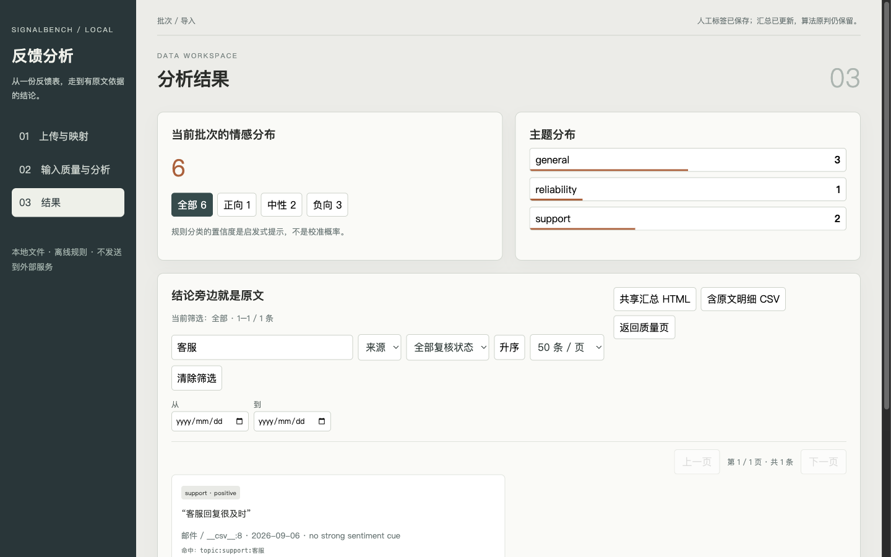

# SignalBench

**Turn messy CSV/TSV/XLSX comments into quality-gated, resumable reports.**

SignalBench turns heterogeneous CSV/TSV/XLSX exports into a traceable analysis
artifact:

```text
source tables → schema contract → quality gate → stable fingerprints
             → resumable classification → aggregate report (CSV/JSON/HTML)
```

The bundled demo is deliberately small and synthetic. It is meant to show the
complete user path in one command, not to imply production accuracy:

```bash
uv run signalbench demo --output-dir outputs/demo
open outputs/demo/report/report.html
```

It is deliberately safe as a baseline: the default classifier is deterministic,
offline, and explainable. No network call is made and no raw author value is
written to the prepared output (only a short audit hash).

## Why this is more than a sentiment demo

- **Input contract** — column aliases are resolved explicitly; missing text
  columns fail with an actionable error instead of silently producing an empty
  dataset.
- **Quality before inference** — blank, link-only, boilerplate, platform-notice,
  encoding-corrupted, symbol-only, and too-short rows are separated from valid
  evidence.
- **Stable evidence IDs** — every row gets a deterministic ID and text
  fingerprint for the same source locations, so a result can be traced back to
  source file/sheet/row without exposing an absolute path.
- **Resume without guesswork** — checkpoints carry a preparation digest and
  classifier version. A checkpoint from another input is rejected rather than
  merged accidentally; writes are atomic.
- **Uncertainty is visible** — review flags, confidence, and a Wilson 95%
  interval accompany the negative-rate headline.
- **Publishable artifacts** — row-level CSV and the full input manifest stay
  local. The aggregate CSV/JSON and the self-contained HTML report carry counts,
  rates, and digests only: `report.json` records file hashes and counts, never
  source file names or the original column headers.

## Quick start

Requires Python 3.11+ and [uv](https://docs.astral.sh/uv/).

```bash
uv sync --extra dev
uv run signalbench run examples/comments.csv --output-dir outputs/demo
open outputs/demo/report/report.html
```

For an installed wheel, the same path is available through the package entry
point once the release artifact is installed:

```bash
signalbench demo --output-dir /tmp/signalbench-demo
```

The command creates:

```text
outputs/demo/
├── prepared.csv              # row-level quality and source fields
├── prepared.xlsx             # spreadsheet-friendly copy of prepared rows
├── classified.csv            # row-level decisions (synthetic input only)
├── classified.xlsx           # spreadsheet-friendly copy of classified rows
├── checkpoint.json           # digest-bound, privacy-minimal resume state
├── input_manifest.json       # file hashes, detected sheets/columns, row counts
├── quality_summary.csv
└── report/
    ├── classification_summary.csv
    ├── quality_summary.csv
    ├── report.json
    └── report.html
```

For a staged run:

```bash
uv run signalbench inspect examples/comments.csv
uv run signalbench prepare examples/comments.csv --output-dir outputs/demo
uv run signalbench classify --prepared outputs/demo/prepared.csv --output-dir outputs/demo
uv run signalbench summarize --classified outputs/demo/classified.csv --output-dir outputs/demo/report
```

The same commands accept a directory or multiple files. XLSX workbooks are
read sheet by sheet; supported text-column aliases include `text`, `comment`,
`content`, `评论`, `评论内容`, and `留言`.

## Local workbench

The workbench keeps files and SQLite state on this machine. Build the React
client once; the build writes into the Python package so both a source checkout
and the standalone wheel can serve the same UI and API from one origin:

```bash
cd web && pnpm install && pnpm build
cd .. && uv run signalbench serve --host 127.0.0.1 --port 5201
```

Open http://127.0.0.1:5201/. During UI development, run `pnpm dev` from
`web/`; Vite listens on `127.0.0.1:5173` and proxies `/api` to port 5201.
The service owns uploaded assets beneath `runtime/signalbench/`; browser
requests use asset IDs and batch IDs, never server filesystem paths.

Quality and result rows are filtered and cursor-paged by the API (up to 200
rows per request). The local URL retains the batch/run, filters, sort order,
review state, page size, and cursor so refresh returns to the same view. The
“keep the first duplicate” action is a single server-side review revision and
works across the full 10,000-row input limit; ordinary manual review requests
remain capped at 500 updates.



The workbench preserves the parts that make the analysis reviewable: every
sheet is mapped explicitly, the quality page shows the current included and
excluded denominator, duplicate groups remain traceable, and each result links
the final label to its source text and rule hits. Human changes keep the
algorithm's original label and reason. Date, sentiment, topic, text, and review
status filters apply to the HTML/CSV export created from that view. Batch
comparison shows reference/current distributions and structural distances
while labelling samples below 30 as descriptive only.

For the first workbench walkthrough, use `examples/clean_feedback.csv` to see
an ordinary batch and `examples/needs_review.csv` to exercise duplicate
handling, soft exclusions, invalid dates, mixed cues and human review. Both are
synthetic fixtures; neither is customer evidence or a production result.

## Workbench import contract

The legacy CLI commands above retain alias detection for scripted use. The
user-facing workbench import path is deliberately explicit: first call
`signalbench.adapters.inspect_inputs()` to list sheets and bounded previews,
then create a `SheetMapping` for each selected sheet and pass those mappings to
`prepare_mapped_pipeline()`. A mapping is bound to the source SHA-256, sheet,
exact source columns, and optional date format. It cannot silently apply to a
changed file or a different sheet.

`prepare_mapped_pipeline()` writes `record_metadata.json` beside the existing
prepared artifacts and initializes `reviews.sqlite`. Review actions are
append-only and leave source text and `prepared.csv` unchanged. By default,
only valid rows enter an analysis; a reviewer may include a soft quality
exclusion with a reason, while blank, encoding-corrupt, and control-character
rows remain excluded. A mapped batch includes a `mapped_preparation_digest` so
the task service can reject a checkpoint from a different mapping.

In this monorepo, the adapter uses the neighboring DataSentinel package for
schema validation and drift profiling. The SignalBench wheel does not depend on
the unrelated package with the same name from PyPI; it carries a small,
standard-library compatibility path for these four declared structural fields.
This keeps a standalone wheel runnable while preserving the richer local
DataSentinel integration during development.

## Reliability contract

`classify` re-runs the quality gate when it reads `prepared.csv` and rejects any
row whose label does not match its text, so an edited file cannot smuggle an
excluded row past the gate. It then processes only rows marked
`quality_label=valid`. Each batch is
validated for an exact one-to-one mapping of IDs. On a transient exception it
retries with bounded exponential backoff. After every completed batch the
checkpoint is atomically replaced. A resumed run:

1. verifies the preparation digest and classifier version;
2. reapplies only completed decisions;
3. classifies the remaining IDs in source order.

This makes failure/recovery a testable behavior rather than a README promise.

## Custom rules and adapters

Start from `config/example.json` and pass `--config`. The configuration is
deep-merged over safe defaults, so a project only needs to override the terms
or thresholds it owns.

The classifier boundary is the small `Classifier` protocol in
`src/signalbench/classify.py`:

```python
class Classifier(Protocol):
    name: str
    def classify(self, records: Sequence[PreparedRecord]) -> list[ClassificationResult]: ...
```

An external model adapter can implement that protocol, while the same quality
gate, checkpoint validation, report schema, and tests remain in place. Keep
credentials and client data outside this repository.

For a cleared model run that must be replayed without network access, use the
strict `replay` adapter. Its JSON contains decisions keyed by `record_id` (no
source text):

```bash
uv run signalbench classify \
  --prepared outputs/demo/prepared.csv \
  --classifier replay \
  --replay /path/to/cleared-decisions.json \
  --output-dir outputs/demo
```

Missing or extra IDs fail loudly, so a partial model export cannot masquerade
as a complete analysis.

The data-flow invariants and extension seam are documented in
[`docs/architecture.md`](docs/architecture.md); data-handling rules are in
[`SECURITY.md`](SECURITY.md).

## Verification

```bash
uv run pytest
uv run --with ruff ruff check src tests
uv run signalbench run examples/comments.csv --output-dir /tmp/signalbench-demo
uv run signalbench evaluate --gold examples/gold.csv --output /tmp/signalbench-gold.json
uv run signalbench benchmark --output-dir /tmp/signalbench-benchmark
uv run signalbench audit --root .
```

The test suite covers schema failures, CSV/XLSX ingestion, Unicode and display
issues, duplicate grouping, deterministic labels, retry behavior, checkpoint
resume/mismatch rejection, tampered prepared rows, the negative-rate Wilson
interval, and report generation.

For model limitations, run both `outputs/benchmark` and the deliberately hard
`outputs/error-cases` fixture described in [`ERROR_CASES.md`](ERROR_CASES.md).
The balanced score must not be quoted without the error-set result and its
synthetic-fixture limitation.

For an external check, [`PUBLIC_EVALUATION.md`](PUBLIC_EVALUATION.md) pins the
TweetEval sentiment test split by commit and three file hashes. The current
12,284-row result is **0.512 accuracy / 0.365 macro-F1** and predicts neutral for
86.6% of rows. That weak generalization result is part of the evidence: it
shows why SignalBench presents this classifier as an offline, reviewable
baseline rather than a general sentiment model. The script downloads the source
at evaluation time and writes aggregate metrics only.

`audit` scans publishable text files for high-confidence secret patterns and
optional forbidden terms while ignoring generated directories. Both kinds of
finding are redacted in its output: a secret match reports only that one was
found, and a forbidden-term match reports the term's position in your list
rather than the term. The command is therefore safe to run in CI.

The `demo` command reports the raw, valid, and classified counts together with
the generated report path, making it suitable for a short terminal recording.

`examples/gold.csv` is a twelve-row smoke fixture for contract verification, not
an accuracy claim. The bundled 45-row `examples/benchmark.csv` is the larger
engineering-regression fixture; `signalbench benchmark` records its hash,
per-label metrics, confusion matrix, predicted/actual distributions, and
confidence calibration in `metrics.json` plus a reviewable `summary.md`.
Its annotation guide, source notes, limitations, and balanced label support are
kept next to the fixture. A real externally labeled benchmark still needs independent
labeling and a data/license note before any production claim is made.

## Scope and data hygiene

When a source file has no platform column, SignalBench uses a stable opaque label derived from the input content digest (for example `source-a1b2c3d4e5f6`) rather than the file name. This keeps a shared aggregate report from exposing a filename, but the label has no business meaning; supply a platform column when a reader needs an interpretable source grouping.

The repository contains synthetic examples only. Do not commit raw exports,
author names, API keys, model responses, or generated `outputs/`. The MIT
license applies to this independent implementation; review the license and
the license of any future adapter before publishing an extension.

SignalBench v1 is intentionally a bounded, in-memory workflow: one run accepts at most 100 files, 16 MiB per source file, 128 columns, 10,000 non-empty records, 8,192 characters of comment text per row, and 512 characters for platform/author/explicit-id metadata. `prepared.csv` is held to the same 10,000-record limit. These are fail-closed limits, not a streaming claim; use a separate, reviewed streaming pipeline for larger authorized exports.
