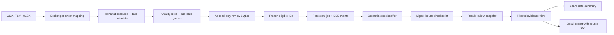

# Architecture

## Invariants

1. A source row receives one stable `record_id`; duplicate IDs fail the input
   contract instead of being merged.
2. Quality decisions happen before inference. Invalid and display-corrupted
   rows are never sent to a classifier.
3. A classifier must return exactly one result for every ID in a batch. Missing,
   extra, or duplicate results fail the batch.
4. Checkpoints are bound to the preparation digest, configuration digest, and
   classifier version. A changed input or rule set cannot silently reuse old
   decisions.
5. Checkpoints contain IDs and decisions only. Aggregate reports do not include
   row text, source filenames, or author hashes.
6. A run freezes eligible record IDs and its review snapshot. Later human label
   changes update that run's aggregate view without rewriting source rows or
   pretending that the classifier ran again.
7. Browser requests refer to imports, assets, batches, jobs, and artifacts by
   server-issued IDs. They never submit an arbitrary server path.
8. Summary exports follow the active result filter and omit source text. Detail
   exports state that they contain original text and preserve review evidence.
9. Quality and result endpoints filter, sort, and return cursor pages (maximum
   200 rows). The URL preserves the batch/run and query state; page reads still
   operate over the bounded, in-memory 10,000-row input envelope.
10. The Vite production build is stored inside the Python package so the same
    FastAPI `serve` command works from a source checkout and standalone wheel.

## Runtime state

The FastAPI service owns one local state directory. `state.sqlite` registers
imports, batches, and artifact IDs; each mapped batch has immutable prepared
artifacts and an append-only review database; each run has its own checkpoint,
classified rows, events, review snapshot, and exports. A process restart marks
unfinished jobs as `interrupted` so the operator can resume them against the
same preparation digest.

Structure comparison uses DataSentinel when the neighboring development
package is installed. A standalone SignalBench wheel uses the adapter's
standard-library implementation for the same declared fields, which avoids
accidentally importing the incompatible public package with the same name.

## Extension seam

The only provider-specific surface is the `Classifier` protocol. A network or
local model adapter can be added without changing ingestion, quality, resume,
or report behavior. Adapter tests should first pass the existing synthetic
fixture and then a separately licensed benchmark.
